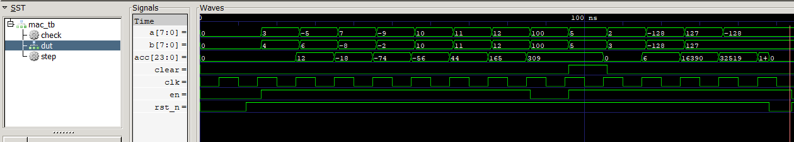

# 8-bit MAC Unit in Verilog

A small multiply-accumulate (MAC) unit in Verilog, simulated with Icarus Verilog. It multiplies two signed 8-bit numbers and adds the result to a running total, which is the basic operation inside the matrix math that AI accelerators do all day.

This is my first hands-on chip design project. I wanted to see what the hardware side looks like after spending time on ML and system-level simulation.

I'm exploring different fields right now. AI is built into most modern technology, so I figured I'd look at the hardware side of it too. It brings new challenges, and it opens up more doors for me in both AI and IC design.

## How I made this

I used Claude to write the Verilog and the testbench. After that I went through the code and studied the simulation output to understand how it works, and to think about what I could explore next.

## Why a MAC unit

Neural networks are mostly multiply and add, repeated millions of times. Chips built for AI put huge arrays of MAC units side by side, so a single MAC is a good small thing to understand first. It also connects to an earlier project of mine, a CPU scheduler simulator (RyzenSchedSimulator), where I modeled processor behavior from the software side. This one goes a layer down to the logic itself.

## What it does

- Takes two signed 8-bit inputs, `a` and `b`
- Multiplies them (16-bit signed product)
- Adds the product to an accumulator on every clock edge when `en` is high
- `clear` resets the accumulator to zero without a full reset
- Accumulator width is a parameter (`ACC_W`, default 24) so it doesn't overflow when adding many products

### Ports

| Port | Direction | Width | Description |
|------|-----------|-------|-------------|
| `clk` | input | 1 | Clock |
| `rst_n` | input | 1 | Active-low reset |
| `en` | input | 1 | Accumulate when high |
| `clear` | input | 1 | Zero the accumulator |
| `a` | input | 8 | Signed operand |
| `b` | input | 8 | Signed operand |
| `acc` | output | `ACC_W` | Running sum |

## Repo layout

```
.
├── rtl/
│   └── mac.v          # the design
├── tb/
│   └── mac_tb.v       # testbench
├── docs/
│   └── waveform.png   # simulation screenshot
└── README.md
```

## How to run it

You need [Icarus Verilog](https://steveicarus.github.io/iverilog/) and [GTKWave](https://gtkwave.sourceforge.net/).

```bash
iverilog -g2012 -o sim rtl/mac.v tb/mac_tb.v
vvp sim
gtkwave waves.vcd
```

The testbench dumps a `waves.vcd` file you can open in GTKWave.

## Results

### Simulation



The testbench checks the accumulator against its own running total after every clock edge. The full run finishes with 516 checks and 0 errors.

Tests I ran:

- reset behavior (at the start and in the middle of a run)
- positive x positive, negative x positive, positive x negative, negative x negative
- accumulating several values in a row
- `en` low holds the accumulator value
- `clear` in the middle of a run
- extreme operands (-128 x -128, 127 x 127, -128 x 127)
- 500 random products checked against a reference total

## What I learned

The main challenges were setup problems, mostly figuring out the PATH so the terminal could find Icarus Verilog. Nothing was really complicated once I followed the steps one at a time. Studying the testbench output and the waveform also helped me see how the accumulator behaves with reset, clear, and negative numbers.

## What's next

I want to turn this into something bigger:

1. Make the design more configurable (operand width, pipeline stages)
2. Run it through an open-source flow many times with different settings and collect area, timing, and power numbers
3. Train a small ML model that predicts those numbers from the design settings, so you don't have to rerun the whole flow each time (a kind of digital twin of the chip)

## Tools

- Verilog (IEEE 1364 / SystemVerilog-compatible syntax)
- Icarus Verilog
- GTKWave

## License

MIT
